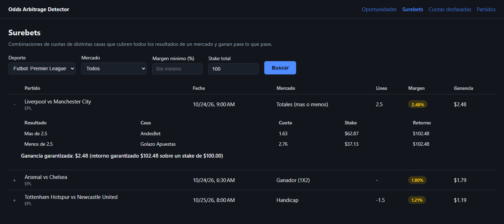
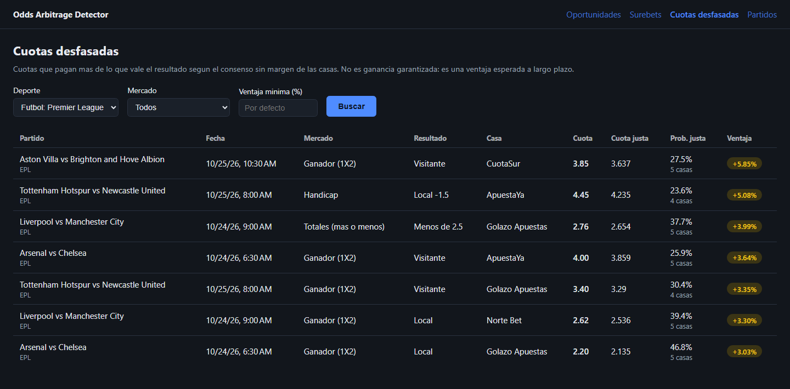
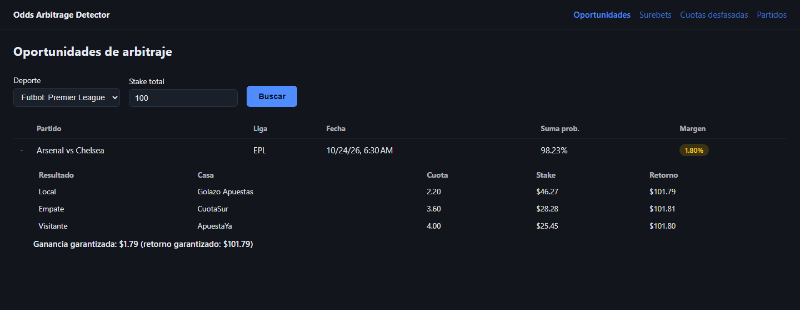

# Odds Arbitrage Detector

[](https://github.com/BrunoPa23/odds-arbitrage-detector/actions/workflows/ci.yml)

Compara las cuotas del mismo partido en distintas casas de apuestas y detecta dos cosas:

- **Surebets** (arbitraje): combinaciones de la mejor cuota de cada resultado que suman menos de 100 % de probabilidad implícita; repartiendo bien el stake se gana pase lo que pase.
- **Cuotas desfasadas** (value bets): cuotas claramente por encima del consenso del mercado; no aseguran ganancia, dan ventaja estadística.

Funciona con los mercados ganador (1X2), totales (más/menos) y hándicap, con datos reales de The Odds API o con un modo demo de datos ficticios.

Proyecto personal de portafolio para practicar C#, ASP.NET Core, Entity Framework y Angular.

> **Aviso**: es un proyecto educativo para practicar desarrollo de software. No es consejo de apuestas ni una herramienta para apostar dinero real: las cuotas cambian en segundos, las casas limitan cuentas que hacen arbitraje y apostar implica riesgo de pérdida.
## Arquitectura

```
odds-arbitrage-detector/
├── OddsArbitrage.Api/     API REST en ASP.NET Core (.NET 10)
├── OddsArbitrage.Tests/   Tests unitarios y de integración (xUnit, WebApplicationFactory)
└── OddsArbitrage.Web/     Frontend en Angular (standalone components)
```

- **OddsArbitrage.Api**: consume cuotas reales de The Odds API, calcula probabilidad implicita por cuota, detecta surebets y cuotas desfasadas en los mercados ganador, totales y handicap, y expone los endpoints (detalle y ejemplos en [Endpoints](#endpoints)):
  - `GET /api/partidos?deporte={clave}`: partidos y sus cuotas por casa de apuestas.
  - `GET /api/oportunidades?deporte={clave}&stake={monto}`: oportunidades de arbitraje detectadas, con el reparto de stake recomendado.
  - `GET /api/surebets?deporte={clave}&mercado={Ganador|Totales|Handicap}&margenMinimo={porcentaje}&stake={monto}`: surebets de todos los mercados consultados (mercado y margenMinimo son opcionales).
  - `GET /api/value-bets?deporte={clave}&mercado={Ganador|Totales|Handicap}&ventajaMinima={porcentaje}`: cuotas desfasadas contra el consenso sin margen de las casas (mercado y ventajaMinima son opcionales; por defecto 3 % y al menos 3 casas, configurable en la seccion `ValueBets`).
- **OddsArbitrage.Web**: consume esos endpoints y muestra filtros por deporte, la tabla de oportunidades (con detalle expandible del reparto), la pagina de surebets (filtro por mercado y margen minimo), la de cuotas desfasadas (filtro por mercado y ventaja minima) y el listado de partidos con sus cuotas. Las paginas solo consultan la API al presionar Buscar.

## Capturas

Tomadas con la API en modo demo (datos ficticios).

**Surebets**: una surebet por mercado (totales, ganador y hándicap) con la fila de totales expandida mostrando el reparto de un stake de 100 entre AndesBet y Golazo Apuestas.



**Cuotas desfasadas**: cuotas por encima del consenso sin margen, con la cuota justa, la probabilidad justa, las casas del consenso y la ventaja esperada.



**Oportunidades (1X2)**: la página del MVP con el reparto del arbitraje en el mercado ganador.



## Cómo funciona: surebets y cuotas desfasadas

Todas las cuotas están en formato decimal: una cuota de 2.50 paga 2.50 por cada 1 apostado (incluido el stake).

### Probabilidad implícita

La probabilidad implícita de una cuota es la probabilidad que la casa "cobra" por ese resultado:

```
p = 1 / cuota
```

Una cuota de 2.00 implica 50 %; una de 4.00, 25 %. En el mercado de una sola casa las probabilidades implícitas suman más de 1: ese exceso es el margen de la casa. Por ejemplo, 2.13 / 3.54 / 3.40 en un 1X2 suman 0.4695 + 0.2825 + 0.2941 = 1.0461, un margen de 4.6 %.

### Condición de surebet

Para cada resultado del mercado se toma la mejor cuota entre todas las casas. Si la suma de sus probabilidades implícitas es menor a 1, hay surebet:

```
S = Σ 1 / mejor_cuota_i  < 1
margen = 1 / S - 1
```

Con un stake total `T`, el reparto que iguala el retorno en todos los resultados es proporcional a la probabilidad implícita de cada cuota:

```
stake_i   = T × (1 / cuota_i) / S
retorno   = stake_i × cuota_i = T / S     (igual para todos los resultados)
ganancia  = T / S - T
```

**Ejemplo** (partido Arsenal vs Chelsea del modo demo, stake de 100):

| Resultado | Mejor cuota | Casa | Prob. implícita | Stake | Retorno |
|-----------|------------:|------|----------------:|------:|--------:|
| Local     | 2.20 | Golazo Apuestas | 0.4545 | 46.27 | 101.79 |
| Empate    | 3.60 | CuotaSur        | 0.2778 | 28.28 | 101.81 |
| Visitante | 4.00 | ApuestaYa       | 0.2500 | 25.45 | 101.80 |
| **Total** |      |                 | **0.9823** | **100.00** | |

`S = 0.9823 < 1`, así que el margen es `1 / 0.9823 - 1 = 1.80 %`. Pase lo que pase se cobran al menos 101.79: una ganancia garantizada de 1.79 sobre 100. Los stakes se redondean a centavos y la ganancia reportada usa el menor retorno, para que nunca se sobreestime.

### Probabilidad justa sin margen (método proporcional)

Para saber cuánto "vale" de verdad cada resultado hay que quitarle el margen a cada casa. El método proporcional reparte el margen en proporción a cada probabilidad implícita, de modo que las probabilidades de la casa sumen 1:

```
p_justa_i = (1 / cuota_i) / Σ (1 / cuota_j)       (por casa)
consenso_i = promedio de p_justa_i entre las casas
```

Solo entran al consenso las casas que cotizan todos los resultados del mercado y línea, y hacen falta al menos 3 casas (`ValueBets:MinimoCasas`) para que el promedio no dependa de una sola.

### Ventaja esperada de una cuota

Si la probabilidad justa del consenso es correcta, la ganancia esperada por unidad apostada es:

```
ventaja = cuota × p_justa - 1
cuota_justa = 1 / p_justa
```

Una cuota es **desfasada** cuando su ventaja es positiva y mayor o igual al umbral (`ventajaMinima`, 3 % por defecto en `ValueBets:VentajaMinimaPorcentaje`).

**Ejemplo** (Aston Villa vs Brighton del modo demo, mercado ganador, resultado visitante): las cinco casas, ya sin margen, dan al visitante 0.2812, 0.2789, 0.2798, 0.2812 y 0.2537. El consenso es `p_justa = 0.2749`, es decir una cuota justa de `1 / 0.2749 = 3.64`. CuotaSur paga 3.85:

```
ventaja = 3.85 × 0.2749 - 1 = 0.0585  →  5.85 %
```

A diferencia de una surebet, esto no es ganancia segura: es la ganancia promedio si se repitiera muchas veces una apuesta así y el consenso acertara.

### Mercados soportados y emparejamiento de líneas

| Mercado (`mercado`) | Clave en The Odds API | Resultados | Línea |
|---------------------|-----------------------|------------|-------|
| `Ganador`  | `h2h`     | Local, Empate, Visitante | sin línea |
| `Totales`  | `totals`  | Más, Menos               | total de goles o puntos (ej. 2.5) |
| `Handicap` | `spreads` | Local, Visitante         | hándicap del local (ej. -1.5) |

Cada combinación de mercado y línea es un mercado independiente: un mismo partido puede tener varias surebets (por ejemplo en totales 2.5 y 3.5) y nunca se mezclan cuotas de líneas distintas.

- **Totales**: ambos lados comparten la línea. "Más de 2.5" se cubre con "Menos de 2.5".
- **Hándicap**: el visitante cotiza la línea opuesta. "Local -1.5" se cubre con "Visitante +1.5", y el grupo se identifica por la línea del local (-1.5). Así, si una casa ofrece Local -1.5 y otra Visitante +1.5, se comparan entre sí; un Visitante +1.0 no se empareja con ellas.

En la NBA el mercado ganador no tiene empate, así que solo se evalúan totales y hándicap.

### Endpoints

Todos los parámetros son opcionales. `deporte` es una clave de The Odds API (por defecto `TheOddsApi:DeportePorDefecto`, `soccer_epl`). Los tres endpoints de detección reutilizan la cache de partidos, así que no gastan cuota adicional.

```http
### Partidos con sus cuotas por casa
GET /api/partidos?deporte=soccer_epl

### Surebets del mercado ganador (el endpoint del MVP)
GET /api/oportunidades?deporte=soccer_epl&stake=100

### Surebets de todos los mercados
GET /api/surebets?deporte=soccer_epl

### Solo totales con margen de al menos 2 % y stake de 500
GET /api/surebets?deporte=soccer_germany_bundesliga&mercado=Totales&margenMinimo=2&stake=500

### Cuotas desfasadas con el umbral por defecto (3 %)
GET /api/value-bets?deporte=soccer_epl

### Cuotas desfasadas de hándicap con ventaja de al menos 5 %
GET /api/value-bets?deporte=soccer_epl&mercado=Handicap&ventajaMinima=5
```

| Parámetro | Endpoints | Rango |
|-----------|-----------|-------|
| `deporte` | todos | letras minúsculas, números y `_` |
| `mercado` | surebets, value-bets | `Ganador`, `Totales`, `Handicap` |
| `margenMinimo` | surebets | 0 a 100 (%) |
| `ventajaMinima` | value-bets | 0 a 100 (%) |
| `stake` | oportunidades, surebets | 1 a 1 000 000 (100 por defecto) |

Un parámetro fuera de rango devuelve 400; un fallo de The Odds API, 502 o 504. Totales y hándicap solo aparecen con datos reales si están activados en `TheOddsApi:Mercados` (cada mercado extra multiplica el costo de cada consulta); en modo demo siempre están.

Respuesta resumida de `GET /api/surebets?mercado=Totales`:

```json
[
  {
    "partidoId": "demo-epl-002",
    "equipoLocal": "Liverpool",
    "equipoVisitante": "Manchester City",
    "mercado": "Totales",
    "linea": 2.5,
    "sumaProbabilidadesImplicitas": 0.975816,
    "margenPorcentaje": 2.48,
    "reparto": {
      "stakeTotal": 100.00,
      "apuestas": [
        { "cuota": { "casa": { "nombre": "AndesBet" }, "resultado": "Mas", "valor": 1.63 }, "stake": 62.87, "retorno": 102.48 },
        { "cuota": { "casa": { "nombre": "Golazo Apuestas" }, "resultado": "Menos", "valor": 2.76 }, "stake": 37.13, "retorno": 102.48 }
      ],
      "retornoGarantizado": 102.48,
      "gananciaGarantizada": 2.48
    }
  }
]
```

### Modo demo

El modo demo sirve un fixture versionado (`OddsArbitrage.Api/Datos/cuotas-demo.json`) con 12 partidos ficticios de Premier League, La Liga, Serie A, Bundesliga y NBA, 5 casas de apuestas inventadas y los mercados h2h, totals y spreads. Incluye surebets en los tres mercados y varias cuotas desfasadas. No necesita API key y nunca llama a The Odds API; las fechas se desplazan solas para que los partidos queden siempre en el futuro.

| Dónde | Cómo activarlo |
|-------|----------------|
| `dotnet run` | `dotnet run --launch-profile demo` |
| Variable de entorno | `TheOddsApi__ModoDemo=true` |
| `appsettings` | `"TheOddsApi": { "ModoDemo": true }` |
| Docker Compose | `MODO_DEMO=true` en el `.env` o `MODO_DEMO=true docker compose up --build` |

Por defecto está apagado y la API se comporta igual que antes. Los tests de integración y el job de Docker del CI usan este modo.

## Como correr la API

Requisitos: .NET 10 SDK.

```bash
cd OddsArbitrage.Api
dotnet run
```

Por defecto queda disponible en `https://localhost:7279` (y `http://localhost:5162`); puede variar segun `Properties/launchSettings.json`.

### Configuracion de la API

La clave de The Odds API nunca se guarda en el repositorio. Se configura con user secrets (desarrollo) o una variable de entorno (otros ambientes):

```bash
cd OddsArbitrage.Api
dotnet user-secrets set "TheOddsApi:ApiKey" "tu-api-key"
```

O, como variable de entorno:

```bash
# PowerShell
$env:TheOddsApi__ApiKey = "tu-api-key"
```

El plan gratuito de The Odds API tiene un limite de 500 requests al mes; el servicio usa cache en memoria (`TheOddsApi:MinutosCache`) para no gastar cuota en cada consulta.

Los origenes permitidos por CORS para el frontend se configuran en `appsettings.json`, bajo `Cors:OrigenesPermitidos` (por defecto incluye `http://localhost:4200`).

### Modo demo (sin API key)

Con `TheOddsApi:ModoDemo=true` la API sirve partidos ficticios de `OddsArbitrage.Api/Datos/cuotas-demo.json` (5 ligas, 5 casas, mercados h2h, totals y spreads) en lugar de llamar a The Odds API: no necesita API key y no gasta cuota. Por defecto esta apagado.

```bash
cd OddsArbitrage.Api
dotnet run --launch-profile demo
```

O, como variable de entorno:

```bash
# PowerShell
$env:TheOddsApi__ModoDemo = "true"
```

## Como correr el frontend

Requisitos: Node.js LTS.

```bash
cd OddsArbitrage.Web
npm install
npm start
```

Queda disponible en `http://localhost:4200`. El proxy configurado en `proxy.conf.json` redirige las llamadas a `/api` hacia la API en `https://localhost:7279`, asi que conviene tener la API corriendo antes de abrir el frontend.

Para compilar en modo produccion:

```bash
npm run build
```

Para correr los tests unitarios:

```bash
npm test
```

## Como correr todo con Docker Compose

Requisitos: Docker con Docker Compose.

1. Copia `.env.example` como `.env` y pon tu API key de The Odds API (el archivo `.env` no se sube al repositorio). Para probar sin API key, pon `MODO_DEMO=true` en el `.env` o levanta el stack con `MODO_DEMO=true docker compose up --build`.
2. Levanta la API y la web:

```bash
docker compose up --build
```

- Web: `http://localhost:8080` (nginx sirve el frontend y reenvia `/api` a la API, asi que no hace falta configurar CORS).
- API: `http://localhost:5162` (por ejemplo `/api/oportunidades`).

Cada consulta que no este en cache gasta cuota de The Odds API; no dejes la web abierta recargando sin necesidad.

## Estado del proyecto

Desarrollo por sprints cortos (metodologia agil, backlog MoSCoW). MVP completo: backend con datos reales de The Odds API, algoritmo de deteccion de arbitraje, frontend en Angular que muestra las oportunidades y los partidos, tests unitarios con CI en GitHub Actions y arranque con Docker Compose.

Fase de surebets y cuotas desfasadas completa: mercados totales y hándicap, detector de surebets por línea, consenso sin margen y detector de cuotas desfasadas, páginas nuevas en Angular, modo demo y tests de integración con `WebApplicationFactory`.

Pendiente: separación en capas (Clean Architecture ligera), histórico en base de datos, alertas en tiempo real (SignalR) y jobs automáticos en background.
